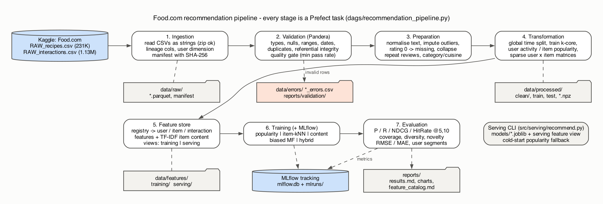
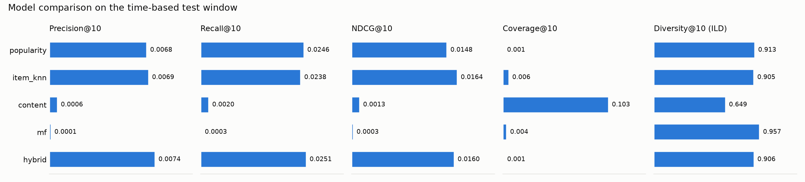

# End-to-End Data Management Pipeline for a Recipe Recommender (Food.com)

**Yash Sharma · Roll No. 2025AG05572** · DM4ML Assignment 2 · <https://github.com/2025ag05572-gif/bitsdm4mlas2>

This repo is a reproducible pipeline that takes the raw Food.com recipe/review data
from Kaggle all the way to evaluated recommendation models:

```
Ingestion → Validation → Preparation → Transformation → Feature store → Tuning → Training (MLflow) → Evaluation
                                   orchestrated as a Prefect flow
```



## Dataset

[Food.com Recipes and User Interactions](https://www.kaggle.com/datasets/shuyangli94/food-com-recipes-and-user-interactions)
(Majumder et al., EMNLP 2019): 231,637 recipes and 1,132,367 reviews (2000–2018) with 0–5 star ratings.

| Entity | Source | Fields used |
|---|---|---|
| Items (recipes) | `RAW_recipes.csv` | name, minutes, contributor, submitted date, tags, nutrition (7 values), steps, ingredients, description |
| Interactions | `RAW_interactions.csv` | user, recipe, date, rating (0 = review without stars), review text |
| Users | *reconstructed* | Food.com has no profile table, so ingestion builds one row per account seen as a reviewer or contributor (member since, #recipes contributed, …) |

## Project structure

```
recommendation-pipeline/
├── configs/            config.yaml (all parameters), config.sample.yaml (smoke test overrides)
├── dags/               recommendation_pipeline.py  ← Prefect flow (the DAG)
├── data/
│   ├── raw/            source/ (Kaggle zip goes here), *.parquet, ingestion_manifest.json
│   ├── processed/      validated/, clean/, train/test, summaries, sparse matrices, id indexes
│   ├── features/       training/ and serving/ feature views
│   └── errors/         quarantined rows (*_errors.csv) + warning flags
├── src/
│   ├── ingestion/      ingest.py
│   ├── validation/     schemas.py (Pandera), validate.py
│   ├── preparation/    prepare.py
│   ├── transformation/ transform.py
│   ├── features/       registry.py, build.py, store.py
│   ├── training/       models.py, tune.py, train.py
│   ├── evaluation/     metrics.py, evaluate.py, plots.py
│   ├── serving/        recommend.py
│   └── pipeline.py     runs all stages without Prefect
├── models/             trained models (*.joblib) + registry.json (MLflow run ids)
├── reports/            validation report, feature catalog, evaluation results, figures, final report
├── scripts/            make_sample_data.py, build_report.py
├── tests/              pytest: metrics, validation rules, quality gate, split/k-core
├── Makefile, requirements.txt
```

## Setup

Requires Python 3.10+ (tested on 3.11, macOS).

```bash
python3.11 -m venv .venv
.venv/bin/pip install -r requirements.txt          # or: make setup
```

Download the dataset (needs a free Kaggle account): open the Kaggle link above → **Download** → put
`archive.zip` (or just `RAW_recipes.csv` and `RAW_interactions.csv`) in `data/raw/source/`.
You don't need to unzip it; ingestion reads the two CSVs straight out of the zip.
Or, with `~/.kaggle/kaggle.json` set up, `pip install kaggle` and set `ingestion.source: kaggle`.

## Running

```bash
# 1) orchestrated run with the Prefect UI (both servers bind to 127.0.0.1 only)
make prefect-server                 # terminal 1 -> http://127.0.0.1:4210
make flow                           # terminal 2: runs dags/recommendation_pipeline.py

# 2) same stages without Prefect
make pipeline                       # = python -m src.pipeline [--from-stage features]

# 3) one stage at a time
.venv/bin/python -m src.ingestion.ingest
.venv/bin/python -m src.validation.validate
.venv/bin/python -m src.preparation.prepare
.venv/bin/python -m src.transformation.transform
.venv/bin/python -m src.features.build
.venv/bin/python -m src.training.tune               # optional; writes models/best_params.json
.venv/bin/python -m src.training.train [--models mf hybrid]
.venv/bin/python -m src.evaluation.evaluate

# experiment tracking UI
make mlflow-ui                      # http://127.0.0.1:5000

# recommendations for one user (serving feature view; unknown users get the cold-start fallback)
make recommend USER=<user_id>

# quick smoke test on a synthetic sample in the same file format (≈20 s)
make sample
make test
```

`python dags/recommendation_pipeline.py --serve` registers a `weekly-retrain` deployment (cron `0 3 * * 1`).

## What each stage does

| Stage | Module | Output |
|---|---|---|
| Ingestion | `src/ingestion/ingest.py` | Reads the CSVs **as strings** (so badly typed values get caught by validation instead of crashing the reader), adds lineage columns (`_row_id`, `_source_file`), reconstructs the user table, writes Parquet and a manifest with SHA-256 checksums. The data is landed exactly as delivered; nothing is modified or added. |
| Validation | `src/validation/` | Type coercion checks → Pandera schema (nulls, ranges, allowed ratings, date window) → duplicates, duplicate keys, referential integrity (interaction → recipe, interaction → user) → soft warnings. Error rows are quarantined in `data/errors/` with the rules they broke, and a quality gate stops the flow if a table's pass rate drops below 95%. Report: `reports/validation/validation_report.md`. |
| Preparation | `src/preparation/prepare.py` | Normalises text and tags, splits nutrition into 7 columns, sets implausible minutes/calories to missing and imputes the category median, maps rating 0 to missing (the interaction stays as an implicit signal), collapses repeat reviews of the same recipe (keeps the latest), derives category and cuisine from tags. |
| Transformation | `src/transformation/transform.py` | Global **time-based split** (latest 10% of reviews by date = test), 5-core filter on train only, warm-start test set, user activity summary, item popularity, sparse user×item interaction and rating matrices. |
| Features | `src/features/` | A custom feature store. `registry.py` defines 36 features (user, item and interaction features, plus a TF-IDF content vector). `build.py` materialises a **training** view (as of the cutoff, point-in-time correct) and a **serving** view (all data). `store.py` is the read API used by training, evaluation and serving. Catalog: `reports/feature_catalog.md`. |
| Tuning | `src/training/tune.py` | Splits the *train* period again by time (the latest 10% becomes a validation window), rebuilds features as of that inner cutoff, and runs a grid search (35 trials logged as nested MLflow runs). Writes `models/best_params.json`, which training merges over the config. The test set is never used here. |
| Training | `src/training/` | Popularity baseline, item-kNN CF, content-based (TF-IDF), biased matrix factorisation (SGD), and a hybrid. Params, data stats, fit time, learning curve and artifacts are logged to MLflow. |
| Evaluation | `src/evaluation/` | Precision/Recall/NDCG/HitRate@5,10, catalog coverage, intra-list diversity, category diversity, novelty, RMSE/MAE, results by user-activity segment. Metrics are logged back to each model's MLflow run. |

## Results

See [`reports/evaluation/results.md`](reports/evaluation/results.md) and the final report
([`reports/final_report.pdf`](reports/final_report.pdf)).

Test window 2014-02-26 → 2018-12-20 (latest 10% of reviews), 2,235 warm-start users, K = 10:

| Model | P@10 | R@10 | NDCG@10 | HitRate@10 | Coverage@10 | Diversity@10 | RMSE | MAE |
|---|---|---|---|---|---|---|---|---|
| Popularity (baseline) | **0.0068** | **0.0246** | 0.0148 | **0.0591** | 0.0011 | 0.913 | 0.629 | 0.420 |
| Item-kNN | 0.0063 | 0.0231 | 0.0152 | 0.0559 | 0.0233 | 0.908 | – | – |
| Content (TF-IDF) | 0.0006 | 0.0020 | 0.0013 | 0.0058 | **0.1028** | 0.649 | – | – |
| Biased MF | 0.0001 | 0.0003 | 0.0004 | 0.0009 | 0.0073 | **0.953** | **0.587** | **0.358** |
| Hybrid | 0.0066 | 0.0214 | **0.0164** | 0.0564 | 0.0023 | 0.902 | – | – |

Predicting the global mean rating gives RMSE 0.639 / MAE 0.437.



- **Popularity is hard to beat on Food.com:** the matrix is 99.92% empty, the test window spans almost 5 years, and 94% of star ratings are 4–5.
- **Hybrid** has the best NDCG@10 (+11% over popularity) but low coverage. **Item-kNN** matches popularity on NDCG with 21× the catalog coverage, after tuning showed that down-weighting very heavy reviewers improves validation NDCG by about 60%.
- **MF** gives the best RMSE but ranks poorly, the usual gap between RMSE and top-N accuracy.
- Validation on the real data quarantined **1,246 reviews dated before their recipe was submitted** (`data/errors/interactions_errors.csv`). Every other error rule passed, and the warnings (missing descriptions, 0-minute or 2,147,483,647-minute recipes, star-less reviews) are handled in preparation.

A full run takes about 6 minutes on a laptop (peak RAM about 6 GB).

## Deliverables checklist

| Deliverable | Location |
|---|---|
| Source code (modular) | `src/`, `dags/`, `scripts/` |
| Setup & execution instructions | this README |
| requirements.txt | `requirements.txt` |
| Architecture diagram | `reports/figures/architecture.png` (`.dot` source alongside) |
| Data validation report / logs | `reports/validation/validation_report.md`, `data/errors/*_errors.csv`, `logs/pipeline.log` |
| Feature catalog | `reports/feature_catalog.md` |
| Model evaluation results | `reports/evaluation/results.md`, `model_comparison.png`, MLflow |
| Orchestration DAG + successful run | `dags/recommendation_pipeline.py`, `reports/figures/prefect_flow_run.png`, `prefect_flow_graph.png` |
| Experiment tracking screenshots | `reports/figures/mlflow_runs.png`, `mlflow_compare.png` |
| Hyper-parameter tuning | `reports/tuning/tuning_results.md`, `models/best_params.json` |
| Final report | `reports/final_report.pdf` |
